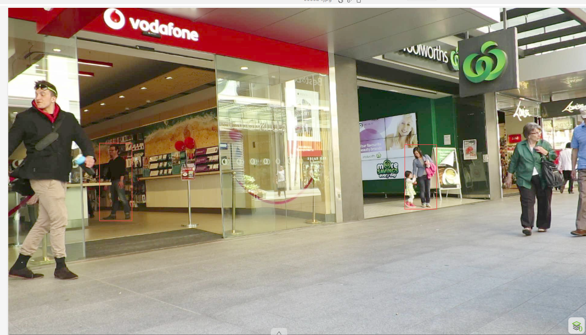
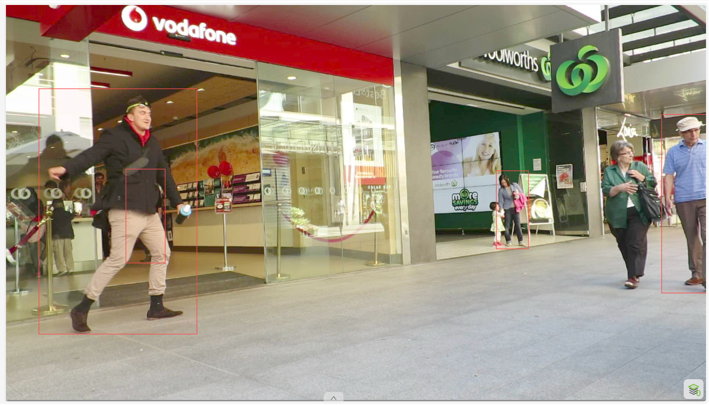
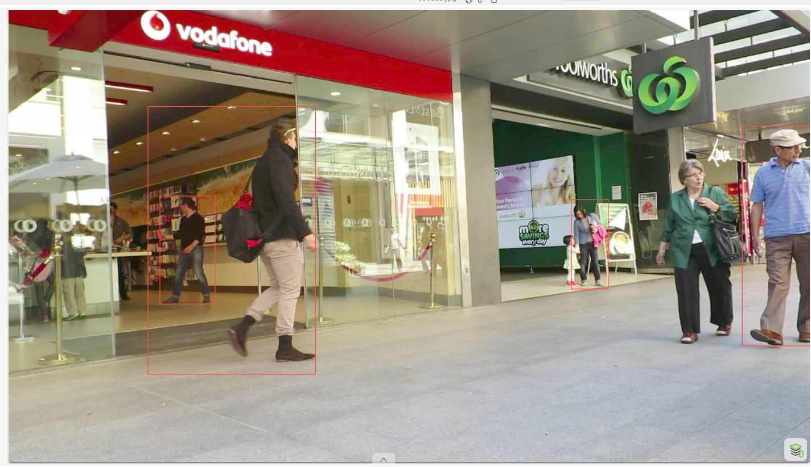

# Báo cáo cá nhân — PhamLamAnh-2A202603029

Đổi tên file theo quy tắc `MSSV_HoTen.md`. Ví dụ: `20241234_NguyenVanAn.md`.

Đoạn video: MOT17-09, 150 frame (frame 1–150), nguồn MOTChallenge, giấy phép CC BY-NC-SA 3.0.

## 0. Thông tin học viên

Họ tên: Phạm Lâm Anh
MSSV: 2A202603029
Mã đề (A/B/C): C (theo tên task trên CVAT: DAY05-MOT17-09-C-03029)
Email: lamanhpham0@gmail.com
Link repository: https://github.com/sui462003/K5-L2-DAY05-PhamLamAnh-03029-MOTTracking
Giờ bắt đầu: 16:27
Giờ kết thúc: 17:52

## 1. Xem trước đoạn video (CP0)

Mã	Điểm nhận diện đề C	Track CVAT	Người trong video
P1	frame 0, điểm (311, 516)	track 0	Người đứng trong cửa hàng Vodafone, bên trái
P2	frame 61, điểm (246, 529)	track 4	Người nhỏ ở sâu trong cửa hàng, bên trái
P3	frame 40, điểm (1875, 425)	track 1	Ông áo xanh, đội mũ be, vào từ mép phải
P4	frame 2, điểm (1331, 508)	track 2	Người dẫn bé gái, ở khoảng giữa phải
P5	frame 28, điểm (147, 398)	track 3	Người áo đen, đeo balo, đi ngang qua trước cửa hàng

Mã	Frame xuất hiện	Frame cuối thấy được	Rẽ / dừng / đổi tốc độ ở frame	Bị che ở frame	Ghi chú
P1	0	149	Đi sang phải với tốc độ không đều (nhanh hơn quanh frame 10–20 và 50–60); đổi chiều nhẹ sang trái quanh frame 95–100	27–72 (bị P5 che; che gần hoàn toàn ở 27–61)	Thấy suốt 150 frame; hộp cao ≈ 256 px (frame 0) đến ≈ 358 px (frame 149)
P2	60	149	Tăng tốc quanh frame 70; chậm lại quanh 90; đổi chiều quanh 110	 (chưa thấy hộp nào chồng lên đáng kể)	Xuất hiện muộn nhất (frame 60)
P3	39	149	Tăng tốc mạnh quanh frame 89–99 (từ ≈ 2 lên ≈ 7 px/frame sang trái)	127–149 (chồng nhẹ với P5, khoảng 10–25% hộp)	Vào từ mép phải; hộp cao ≈ 486 px lúc vào, ≈ 948 px ở frame 149 (lại gần camera)
P4	1	144	Đi chậm đến khoảng frame 31, gần như đứng yên từ khoảng frame 41	 khuất 106–143	Người nhỏ, ở xa (hộp cao ≈ 205–213 px); chỉ thấy lại 1 frame (144) rồi outside từ 145
P5	27	149	Đi rất nhanh (≈ 12,6 px/frame) từ khoảng frame 37; chậm lại quanh 117; ra khỏi khung từ frame 136	Không (là người che P1)	Hộp rất lớn (cao ≈ 673 px, đứng gần camera). Ở ảnh đề C đã thấy phần cơ thể ở mép trái từ frame 0 

## 2. Keyframe và thời gian (CP1, CP4)

Số keyframe lấy từ kết quả `src/check_submission.py`.

Mã (track CVAT)	Số keyframe	Keyframe ở frame	Số frame có mặt	Keyframe / 100 frame	Thời gian (phút)	Chỗ khó
P1 (track 0)	55	0, 4, 5, 12, 14, 15, 16, 17, 19, 20, 21, 22, 24, 26, 27, 28, 31, 32, 33, 34, 41, 51, 53, 56, 57, 63, 65, 68, 72, 74, 80, 82, 85, 87, 92, 95, 97, 100, 103, 106, 109, 110, 112, 115, 119, 121, 123, 129, 131, 133, 135, 143, 145, 148, 149	150	36,7	20 (ước lượng)	Bị P5 che gần hoàn toàn ở frame 27–61; đổi chiều nhẹ quanh frame 95–100
P2 (track 4)	32	60, 67, 68, 69, 70, 72, 73, 74, 75, 76, 77, 78, 79, 80, 83, 84, 88, 89, 98, 102, 111, 117, 125, 128, 130, 133, 138, 140, 141, 142, 144, 149	90	35,6	14 (ước lượng)	Xuất hiện muộn (frame 60); tăng tốc quanh 70, chậm lại quanh 90, đổi chiều quanh 110 nên keyframe dày ở 67–80
P3 (track 1)	54	39, 42, 46, 53, 54, 56, 60, 63, 67, 71, 73, 78, 81, 84, 86, 88, 91, 93, 94, 96, 97, 102, 103, 106, 108, 110, 111, 112, 113, 114, 115, 118, 119, 121, 122, 125, 128, 129, 131, 132, 133, 134, 136, 137, 138, 139, 140, 141, 142, 143, 144, 145, 147, 148	111	48,6	20 (ước lượng)	Đi lại gần camera, hộp to gấp đôi (cao 486 → 948 px); tăng tốc mạnh ở frame 89–99; chồng nhẹ với P5 ở 127–149
P4 (track 2)	7	1, 9, 12, 23, 24, 38, 144	106	6,6	12 (ước lượng)	Người nhỏ, ở xa; gần như đứng yên từ frame 41; khuất 106–143 và chỉ thấy lại 1 frame (144)
P5 (track 3)	9	27, 32, 34, 35, 36, 37, 118, 131, 149	110	8,2	19 (ước lượng)	Hộp lớn nhất, đi nhanh nhất; che P1; ra khỏi khung từ frame 136; chỉ còn 9 keyframe nên phải tua kiểm tra box có trôi không
Tổng	157		567	27,7	85 (ước lượng)	

Keyframe / 100 frame của cả bài = tổng keyframe ÷ tổng số frame có mặt × 100 = ...

Bạn đặt keyframe nhiều nhất ở người nào? Vì sao (người đó rẽ, dừng, lại gần camera hay bị che)? 
Về số lượng thì nhiều nhất là P1 (55 keyframe), nhưng người này thấy suốt 150 frame nên mật độ chỉ 36,7 / 100 frame. Về mật độ thì cao nhất là P3 với 54 keyframe trên 111 frame (48,6 / 100 frame, sát ngưỡng cảnh báo 50). P3 vào từ mép phải, đi lại gần camera nên hộp cao tăng từ khoảng 486 lên khoảng 948 px và tăng tốc mạnh từ frame 89, nên kích thước và vị trí đổi nhanh. Keyframe dày nhất ở cuối đoạn (frame 131–134, 136–145, 147, 148).Vì người này rẽ.

...

## 3. Đoạn bị che (CP2)

Người bị che: `P_`

Frame	27	28–60	61	62	65	68	70	72	73 trở đi
P1 bị P5 phủ	97%	100%	96%	87%	61%	40%	25%	10%	0%
Bắt đầu bị che một phần (bật occluded)	khoảng 27 hoặc sớm hơn: P5 chỉ có hộp từ frame 27 mà đã phủ 97%, nên cần xem video để tìm frame đầu tiên P5 chạm vào P1
Mất hẳn (bật outside)	28 (phủ 100%)
Hiện lại (tắt outside)	61 hoặc 62 (phủ giảm xuống dưới khoảng 90%)
Thấy rõ trở lại (tắt occluded)	73 (phủ 0%)
Thời gian khuất hẳn: nếu outside từ 28 đến 60 thì 33 frame = 33 ÷ 30 = 1,1 giây (theo mốc bạn chọn trong CVAT, tính lại cho đúng).
Quyết định: giữ cùng ID (khuất khoảng 33–35 frame, dưới ngưỡng 60 frame).
- Lý do (trả lời 3 câu: khuất bao lâu so với 60 frame, ngoại hình có khớp, chỗ hiện lại có đúng hướng và tốc độ): P1 khuất hẳn khoảng 33 frame (khoảng 1,1 giây), ngắn hơn nhiều so với ngưỡng 60 frame (2 giây) của lớp nên theo quy ước phải giữ cùng ID. P1 là người ở trong cửa hàng, sau lớp kính, còn P5 chỉ đi ngang qua phía trước nên P1 không rời khỏi khung hình mà chỉ bị che tạm; trước và sau đoạn che vẫn là cùng một người mặc cùng trang phục. Khi hiện lại ở khoảng frame 62–73, P1 vẫn ở gần vị trí cũ (mép trái hộp dịch từ khoảng x 312 ở frame 27 lên khoảng x 400 ở frame 73, tức đi chậm sang phải khoảng 2 px/frame) nên hướng và tốc độ khớp với trước khi bị che.

...

Ảnh chụp màn hình:

## 4. Tự review ID (CP3)

Lượt 1 theo người (đi ngược từ frame 149 về 0 trên CVAT), lượt 2 theo cảnh (nhảy 10 frame). Ít nhất 3 dòng; không có lỗi thì ghi một dòng "đã kiểm hai lượt, không lỗi".

Loại lỗi dùng đúng một trong 7 mã: `id_switch`, `fragmentation`, `lost`, `merge`, `false_track`, `drift`, `flag`.

| Frame | Mã người | Loại lỗi | Mô tả một câu | Phát hiện ở lượt | Đã sửa? |
|---:|---|---|---|---|---|
| | | | | | |
| | | | | | |
| | | | | | |

Tổng hợp số lỗi theo loại:

| `id_switch` | `fragmentation` | `lost` | `merge` | `false_track` | `drift` | `flag` |
|---:|---:|---:|---:|---:|---:|---:|
| | | | | | | |

Lỗi nào chỉ lượt 2 (theo cảnh) mới thấy, lượt 1 (theo người) không thấy? Vì sao? Không có lỗi nào được ghi nhận ở cả hai lượt nên không có lỗi nào chỉ lượt 2 mới thấy.

...

## 5. File xuất và kết quả tự kiểm (CP4)

Kiểm tra	Kết quả
Tên file MOT 1.1	PhamLamAnh_mot.zip
Tên file CVAT for video 1.1	PhamLamAnh_cvat_video.zip
Số track ID khác nhau trong gt/gt.txt (phải là 5)	5 (ID 1–5, tổng 567 dòng)
Frame outside không có dòng trong gt.txt (đúng / sai)	Đúng. ID 2 trong gt.txt (track 2 CVAT) không có dòng nào ở frame CVAT 106–143 và 145–149, ID 3 không có dòng ở frame 136–148
Job đã completed trên CVAT máy cá nhân đã completed

Dán phần tóm tắt in ra từ `src/check_submission.py`:

=== Tóm tắt ===
  Lỗi: 0   |   Cảnh báo: 0
  Đạt. Dán phần tóm tắt này vào báo cáo mục 5.

## 6. Ba câu kết

1. Nếu được gán lại, bạn sẽ đặt keyframe khác ở đâu? Vì sao?

   Nếu được gán lại, bạn sẽ đặt keyframe khác ở đâu? Vì sao? Lần đầu mình đặt keyframe gần như mỗi frame ở P5 (79 keyframe) vì thấy hộp to nên chỉ lệch chút là muốn sửa ngay, sau đó phải bỏ bớt còn 9. Nếu làm lại, mình sẽ đặt keyframe thưa ở đoạn đi thẳng đều và chỉ dày ở chỗ đổi hướng, đổi kích thước hoặc quanh đoạn bị che, rồi tua F kiểm tra sau, đỡ mất thời gian hơn.

2. Có chỗ nào bạn không chắc "cùng ID hay ID mới"? Bạn đã quyết định và ghi chú thế nào?

   Chỗ mình phân vân nhất là P1 bị P5 che gần hết khoảng 33 frame. Mình giữ cùng ID vì chỉ khuất khoảng 1,1 giây, ít hơn ngưỡng 60 frame, và P1 vẫn ở gần vị trí cũ khi hiện lại. Chỗ P4 chỉ hiện lại đúng 1 frame (144) sau khi vắng 38 frame thì mình cũng giữ cùng ID theo ngưỡng này.

3. Một lỗi ID trong job của bạn (nếu không còn sót, chọn lỗi đã sửa) có thể làm xe tự lái dự đoán sai chuyển động của người đó như thế nào? Lỗi đó ảnh hưởng MOTA hay IDF1 nhiều hơn?

   Lỗi đó ảnh hưởng MOTA hay IDF1 nhiều hơn? Job của mình không còn lỗi ID, nhưng chỗ dễ sai nhất là P1 sau khi P5 đi ngang qua: nếu nhãn đổi sang ID mới hoặc nhảy sang người khác, xe sẽ tưởng người đó đột ngột chạy một đoạn dài và dự đoán sai hướng đi. Lỗi kiểu này (id_switch) chỉ bị trừ một lần trong MOTA, nhưng làm IDF1 giảm nhiều hơn vì IDF1 đo việc giữ đúng một ID trên cả quãng đường.

## Bonus (nếu làm)

### B1 — Hai người đi sát

...

### B2 — So cách đặt keyframe

| Cách đặt | Số keyframe | Frame trôi nhất | Ghi chú |
|---|---:|---:|---|
| Đều mỗi 30 frame | | | |
| Theo chỗ đổi hướng | | | |

...

### B3 — So với tracker có sẵn

| Frame | Mã người | Tracker làm gì | Nhãn của bạn | Giải thích (đoán rồi sửa / ghép IoU / box score thấp / ngoại hình) |
|---:|---|---|---|---|
| | | | | |
| | | | | |

## 7. Tài liệu tham khảo và công cụ AI đã dùng

...
